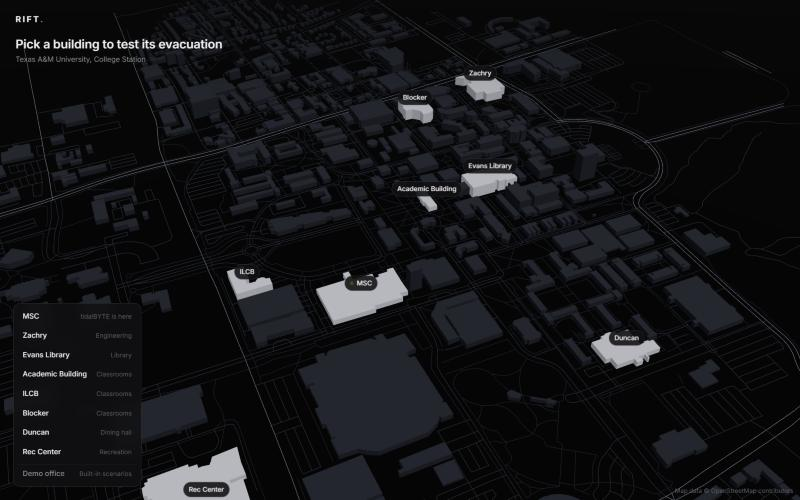
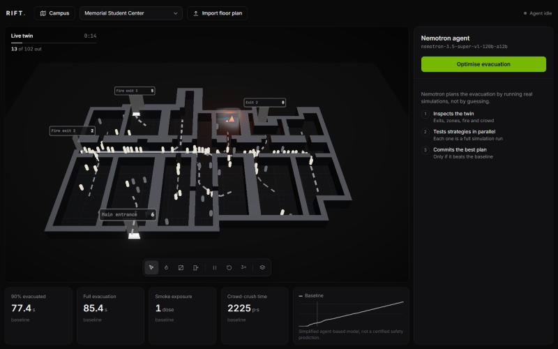
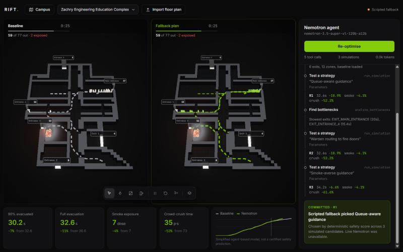

# RIFT

**Built at tidalBYTE '26, Texas A&M, for the main track and NVIDIA's Best Use of Nemotron track.**

- Live Deployment: [rift-safety.netlify.app](https://rift-safety.netlify.app)
- Hackathon: [tidalBYTE '26](https://f26.tidaltamu.com/), a 12-hour hackathon run by tidalTAMU in the MSC on November 21, 2026

RIFT (Reality Intelligence & Future Testing) opens on a 3D map of Texas A&M. Pick a building and it becomes an evacuation digital twin with hundreds of simulated occupants, a spreading fire and drifting smoke. An NVIDIA Nemotron agent then plans the evacuation by running real simulations as tool calls, comparing the results, and committing the plan that beats unguided self-evacuation. Drop an obstacle, start a second fire or block an exit, and it replans on its own.

- **Team:** Vignesh Nagarajan, Srivanth Rudrangi, Anish Koduri, Priyansh Ravrani
- **Prompt:** apply AI and machine learning to real-world problems in ways that create meaningful interdisciplinary impact. The NVIDIA track asks for an agent doing real work, with Nemotron central to it.
- **Sponsors:** Jane Street, NVIDIA, Google Gemini, Adobe, ElevenLabs, Base44 and others
- **Datasets:** [OpenStreetMap](https://www.openstreetmap.org/) footprints, heights, entrances and footpaths for the main campus, via the Overpass API
- **Stack:** React, TypeScript, Vite, three.js (React Three Fiber), Zustand, Web Workers, a Node proxy to NVIDIA's API
- **Run it:** `npm install`, put your build.nvidia.com key in `.env.local` as `NVIDIA_API_KEY`, then `npm run dev`. See [how it works](docs/how-it-works.md) for the model, the simulation and the architecture.
- **Original repo:** Srivanth's original repo is at [github.com/snr2753423/rift](https://github.com/snr2753423/rift), and this repo has been PRed into it.

## Demo

Open the site, pick **MSC** (where tidalBYTE is happening), choose a floor, tap where you are, and sound the alarm. Then ask NVIDIA Nemotron for a better plan and compare.

| Campus map | Twin of the MSC | Baseline vs. Nemotron plan |
|:-:|:-:|:-:|
|  |  |  |

Nemotron has three jobs. As **perception**, Nemotron VL reads a floor-plan image and returns rooms, exits and the likeliest fire source as validated JSON. As **planner**, it inspects the twin, proposes contrasting strategies, runs them in parallel on a Web Worker pool, reads the bottlenecks and commits a plan, with its reasoning streamed under a per-turn budget. As **replanner**, it re-tests its committed plan whenever the building changes. Every number it cites comes from a deterministic simulation it triggered, and `commit_strategy` refuses any plan that scores worse than the baseline.

Building footprints and entrances are real map data, but detailed floor plans for campus buildings are not public. The interior of each campus twin is a schematic generated from its footprint (corridor, rooms, exits at the mapped entrances), and it is scaled to the simulation's 64 × 40 grid. The simulation is a simplified agent-based model for comparing strategies, **not a certified safety prediction**. The deployed site reaches Nemotron through a Netlify Edge Function that keeps the key server-side; a clearly labelled offline fallback drives the same tools only when NVIDIA cannot be reached.
